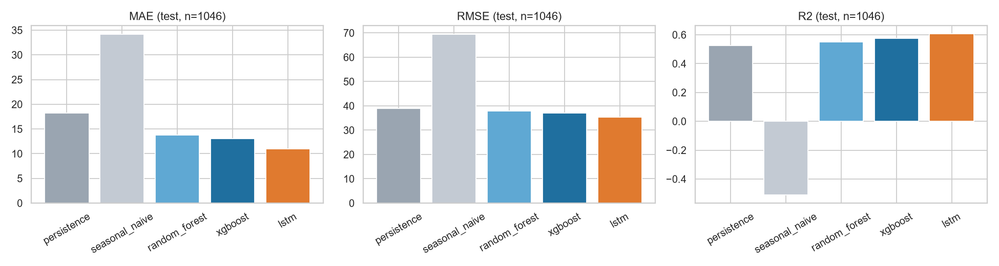
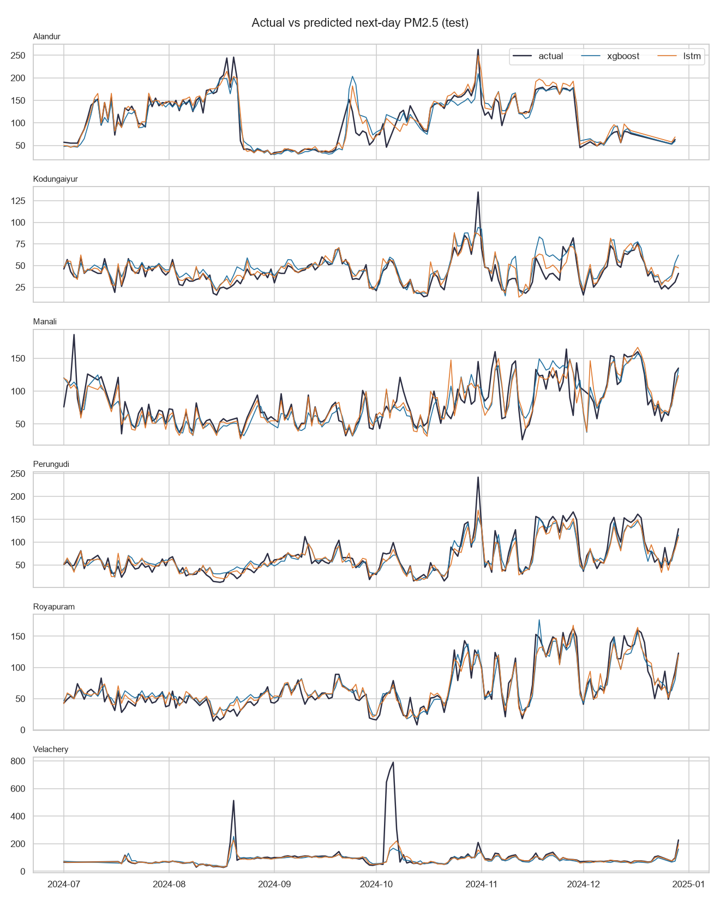
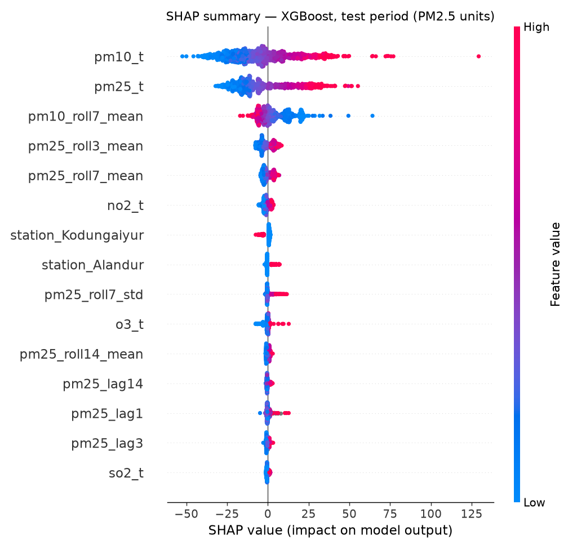

# Chennai Air Quality Intelligence

**Explainable multi-station next-day PM2.5 forecasting with machine learning and deep learning.**

*Academic title: Air Quality Prediction Using Machine Learning*

> Live demo: _to be added after Streamlit Community Cloud deployment_
>
> ⚠️ This is a **historical backtest**. The dataset ends on **31 December 2024**; the app does not
> produce live forecasts.

---

## Problem statement
Fine particulate matter (PM2.5) is the air pollutant most strongly linked to health damage, and city
agencies publish next-day air-quality outlooks so people can plan ahead. This project asks: **given
pollutant readings up to the end of day *t*, how accurately can we forecast PM2.5 on day *t+1* at six
Chennai monitoring stations, and does machine learning or deep learning actually beat simple baselines?**

## Objectives
1. Audit a real public dataset and document its quality problems honestly.
2. Build a leakage-safe time-series preprocessing and feature pipeline (proven by automated tests).
3. Compare persistence and seasonal-naive baselines with XGBoost, Random Forest and an LSTM on a
   chronological hold-out.
4. Explain the XGBoost model with feature importance and SHAP.
5. Ship an interactive Streamlit dashboard and deploy it.

## Features
- 6-page Streamlit dashboard: overview, historical explorer, forecast explorer, model comparison,
  explainability, about
- Per-forecast SHAP breakdown and **live XGBoost re-computation** from data available at the origin date
- Identical-target model comparison (all models scored on the same station-days)
- 22 automated tests incl. future-leakage, station-mixing and target-alignment tests
- One-command reproducible pipeline

## Dataset
*Hybrid Prophet-XGBoost Forecasting for Urban Air Quality with Real-Time Data Integration for Chennai*,
Mendeley Data, V1, DOI: [10.17632/br5dyxm7c6.1](https://data.mendeley.com/datasets/br5dyxm7c6/1).

| | |
|---|---|
| Stations | Alandur, Kodungaiyur, Manali, Perungudi, Royapuram, Velachery |
| Period | 2022-01-01 → 2024-12-31 (daily) |
| Records | 6,184 (392 station-days missing from the calendar) |
| Variables | PM2.5, PM10, NO2, SO2, O3 |

Only the six historical CSVs are used (stored unchanged in `data/raw/`, SHA-256 verified on every run).
The archive's code, models and reported metrics were **not** reused.

**Key data-quality findings** (full detail in [`reports/data_audit.md`](reports/data_audit.md)):
- **PM2.5 > PM10 in 84.3% of rows** (median PM2.5 71 vs PM10 48). Physically PM2.5 ⊂ PM10, so a
  column-labelling or processing issue in the published files is plausible. Columns are used as labelled;
  all results refer to "PM2.5 as published".
- Kodungaiyur reports PM2.5 = 116.0 for **126 consecutive days** (Jan–May 2022) → masked as a filler
  value by a documented QC rule (processed data only).
- Three stations share a 49-day gap (Nov–Dec 2023); many constant runs in SO2/O3 (instrument floors).
- The publisher does not document prior cleaning or imputation, so this is not raw sensor data.

## Architecture
```
data/raw/*.csv ──► audit & validation ──► daily calendar per station (gaps explicit, QC mask)
                                               │
                                               ▼
                         leakage-safe features (origin t → target t+1)
                                               │   split by target date
             ┌──────────────┬──────────────────┼──────────────────┐
        persistence    seasonal naive     XGBoost / RF        LSTM (Keras)
             └──────────────┴────────┬─────────┴──────────────────┘
                         saved predictions + metrics + SHAP
                                     │
                         Streamlit dashboard (no training, no TensorFlow at runtime)
```

## Methodology
**Forecast convention.** At the end of day *t*, predict PM2.5 for day *t+1* using only data dated ≤ *t*.

**Preprocessing.** Each station is reindexed onto a complete daily calendar. No backward fill, no
interpolation, no centred windows. An origin is used only if PM2.5 was recorded on *t* and *t+1*;
labels are never imputed. Other missing inputs remain NaN (handled natively by tree models).

**Features (28).** PM2.5 today and lags 1/2/3/6/7/14; trailing rolling means (3/7/14 days) and 7-day
std; same-day PM10/NO2/SO2/O3 and 7-day PM10 mean; count of observed days in the last week; target-day
calendar (day-of-week, month, cyclical day-of-year, weekend); station one-hot.

**Split (by target date).** Train 2022-01-02 → 2023-12-31 (3,831 rows) · Validation Jan–Jun 2024
(1,082) · Test Jul–Dec 2024 (1,063). Tuning used validation only; test was scored once.

**Models.**
| Model | Details |
|---|---|
| Persistence | ŷ(t+1) = PM2.5(t) |
| Seasonal naive | ŷ(t+1) = PM2.5(t−6), i.e. same weekday last week |
| XGBoost | 24-config grid (depth, learning rate, min-child-weight, raw vs log target), early stopping on val → depth 4, lr 0.03, 314 trees |
| Random Forest | 300 trees, 4-config grid → unlimited depth, min leaf 5 |
| LSTM | 7-day window × (5 pollutants + observed mask) → LSTM(64) → concat(station one-hot, target calendar) → Dense(16, ReLU) → Dense(1); log1p + z-score scaling fitted on training period only; Adam, MSE, early stopping (patience 15); 4-config grid over window {7,14} × units {32,64} |

## Results (genuine, test period Jul–Dec 2024)
All models scored on the **same 1,046 station-days**.

| Model | MAE | RMSE | R² | sMAPE % | MAE vs persistence |
|---|---:|---:|---:|---:|---:|
| **LSTM** | **11.01** | **35.43** | **0.608** | **13.5** | **+39.7%** |
| XGBoost | 13.03 | 36.95 | 0.573 | 16.7 | +28.6% |
| Random Forest | 13.77 | 37.95 | 0.550 | 18.2 | +24.6% |
| Persistence | 18.26 | 38.94 | 0.526 | 23.5 | — |
| Seasonal naive | 34.22 | 69.55 | −0.511 | 40.6 | −87.4% |

Validation (Jan–Jun 2024, 1,053 common rows): LSTM MAE 8.79, XGBoost 9.94, RF 10.09, persistence 14.22.

**Honest reading of the results**
- The LSTM is the best model on both validation and test; XGBoost is second.
- MAE improves strongly, but **RMSE improves only 5–9%** on test: a handful of extreme spikes (max 790)
  dominate squared error and no model anticipates them from pollutant history alone.
- At **Velachery** the learned models have lower MAE than persistence but **lower R²** (LSTM 0.29 vs
  persistence 0.34) — the station's large, abrupt jumps are poorly predicted by every model.
- The LSTM result comes from a single seed; small differences between models should not be over-interpreted.

| Station MAE (test) | LSTM | XGBoost | RF | Persistence |
|---|---:|---:|---:|---:|
| Alandur | 10.68 | 12.39 | 12.13 | 17.75 |
| Kodungaiyur | 5.39 | 6.95 | 8.85 | 9.10 |
| Manali | 13.09 | 14.65 | 15.20 | 21.54 |
| Perungudi | 10.19 | 11.39 | 12.31 | 18.53 |
| Royapuram | 8.31 | 9.94 | 10.73 | 16.95 |
| Velachery | 19.34 | 24.06 | 24.43 | 26.67 |




## Explainability
Top XGBoost drivers on the test period (mean |SHAP|): same-day PM10, same-day PM2.5, 7-day PM10 mean,
3-day and 7-day PM2.5 means. Recent PM2.5 history and same-day co-pollutants each account for about
45% of attribution; station identity ~5%; calendar features very little. These are associations
learned by the model, **not causal effects**.



## Repository structure
```
app.py                     Streamlit dashboard
src/                       config, loading, validation, audit, preprocessing, features,
                           baselines, ML, LSTM, evaluation, plots, explainability, inference
scripts/run_pipeline.py    end-to-end reproduction
tests/                     pytest suite (22 tests)
data/raw|processed/        original CSVs | derived tables
models/                    xgboost_model.json + schema, lstm_model.keras + metadata
results/                   metrics/, figures/, predictions/, explainability/
reports/                   data audit, academic report, viva & presentation notes
```

## Installation & reproduction (Windows, Python 3.11)
```bash
py -3.11 -m venv .venv
.venv\Scripts\python -m pip install -r requirements-dev.txt
.venv\Scripts\python scripts\run_pipeline.py      # audit → data → models → evaluation → SHAP (~3 min CPU)
.venv\Scripts\python -m pytest -q                  # 22 tests
.venv\Scripts\streamlit run app.py
```
> On Windows, TensorFlow fails to import if the venv path is very long (MAX_PATH); create the venv in a
> short folder such as `C:\venvs\caqi` if you see "The filename or extension is too long".

To run only the dashboard: `pip install -r requirements.txt` (no TensorFlow needed).

## Deployment
Streamlit Community Cloud → New app → this repository, branch `main`, main file `app.py`,
Python 3.11. `requirements.txt` contains only runtime packages; all predictions are pre-computed.

## Technology stack
Python 3.11 · pandas · NumPy · scikit-learn · XGBoost · TensorFlow/Keras · SHAP · Matplotlib/Seaborn ·
Plotly · Streamlit · pytest

## Limitations
- PM2.5/PM10 labelling inconsistency in the source data (see above).
- No meteorological inputs (wind, rainfall, humidity, boundary-layer height), which drive day-to-day changes.
- Single-seed LSTM; no prediction intervals; one-day horizon only.
- Historical backtest — the data ends in December 2024.

## Future improvements
- Add ERA5/IMD weather features and festival indicators (e.g. Diwali).
- Multi-seed / ensemble training and quantile forecasts for uncertainty.
- Multi-day horizons; rolling-origin cross-validation.
- Live ingestion from the CPCB API once a reliable feed is available.

## Citation
> Hybrid Prophet-XGBoost Forecasting for Urban Air Quality with Real-Time Data Integration for Chennai.
> Mendeley Data, V1. https://doi.org/10.17632/br5dyxm7c6.1
